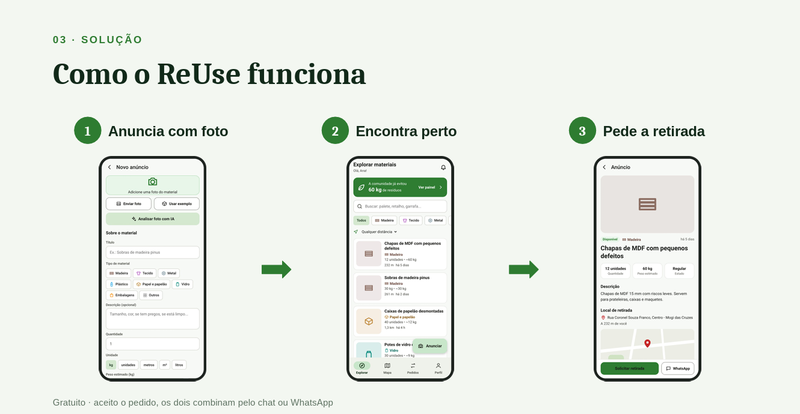

# reuse_project

### ReUse - Plataforma para reaproveitamento de materiais
### Projeto acadêmico - Engenharia de Software - UMC 2026
#

### Integrantes:
  Raphael Henrique dos Santos................11251101602
  Kaynan Henrique de Souza Marques...........11251100298
  Enzo de Campos Cortês......................11251101342
  Miguel Kenzo Oguiura Tanaka................11251102095
  Vinicius Eduardo Quintino Filomeno.........11251102274

### DESCRIÇÃO:
  Plataforma digital de economia circular que conecta pessoas, empresas e instituições para facilitar a doação, a troca e a comercialização de materiais reutilizáveis, promovendo a redução de resíduos, o consumo responsável e o uso eficiente de recursos.

### O passo a passo COMPLETO (com imagens) está no arquivo:
- [Baixar ou visualizar o documento em PDF](./Guia_ReUse_Passo_a_Passo.pdf)

### O QUE TEM AQUI
- banco_de_dados/  -> reuse_banco.sql (importar no phpMyAdmin do XAMPP)
- reuse_api/       -> API em Dart (abrir no VS Code)
- reuse_app/       -> App em Flutter (abrir no VS Code)

### RESUMO RÁPIDO (depois de tudo instalado)
  1) XAMPP: clicar em Start no MySQL
     (na 1ª vez: importar banco_de_dados/reuse_banco.sql no phpMyAdmin)

  2) VS Code com a pasta reuse_api, no terminal:
        dart pub get                 (só na 1ª vez)
        dart run bin/server.dart

  3) Outra janela do VS Code com a pasta reuse_app, no terminal:
        flutter create . --platforms=android,web --org br.umc.reuse   (só na 1ª vez)
        flutter run -d chrome        (no Chrome)
        flutter run                  (no celular Android pelo cabo USB)
        flutter build apk --release  (gera o instalador .apk)

CONTAS DE TESTE (senha de todas: 123456)
  ana@reuse.com  |  marcenaria@reuse.com  |  escola@reuse.com
  | confeccao@reuse.com  |  carlos@reuse.com

Requisitos: Flutter 3.35 ou mais novo (recomendado o mais recente),
XAMPP (MySQL), VS Code com as extensões Dart e Flutter.
